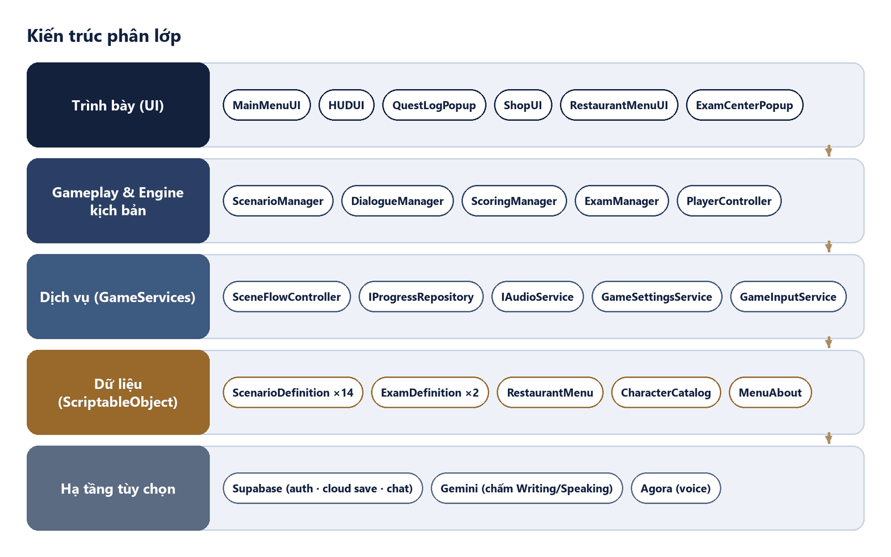
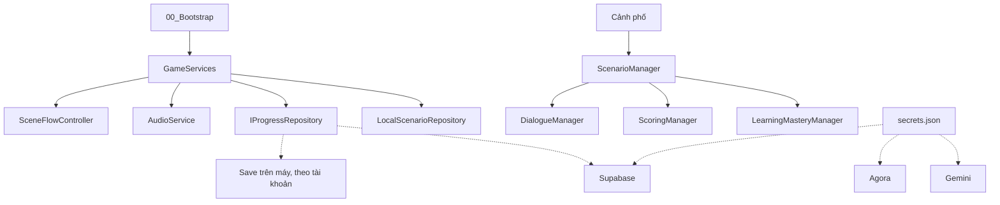
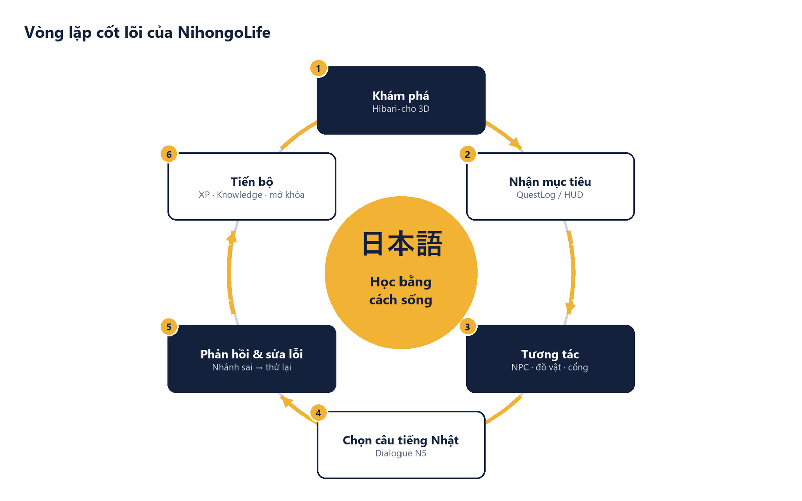

<div align="center">


# NihongoLife · ひばり町

**Học tiếng Nhật bằng cách sống ở Nhật.**

Game 3D mô phỏng cuộc sống ở khu phố Hibari-chō. Người Việt luyện tiếng Nhật qua từng việc hằng ngày:<br/>
chào hàng xóm, mua cơm nắm, hỏi giá vé tàu, gọi sushi, đi học, đi làm thêm, rồi ra đảo trồng rau.

[](NihongoLife/ProjectSettings/ProjectVersion.txt)
[](NihongoLife/Assets/Settings)
[](#chơi-trên-web)
[](#ngôn-ngữ)
[](LICENSE)
[](#đóng-góp)

▶ [**Xem trailer v4b** (720p · 67 giây)](docs/readme/preview_v4b_720p.mp4) · [Kênh YouTube](https://www.youtube.com/channel/UCAKp-_EsasxPY2oa-4CzWtQ)

[Điểm nổi bật](#điểm-nổi-bật) · [Trong game](#trong-game) · [Bắt đầu](#bắt-đầu-nhanh) · [Điều khiển](#điều-khiển) · [Kiến trúc](#kiến-trúc) · [Kiểm thử](#kiểm-thử) · [Đóng góp](#đóng-góp) · [Đội ngũ](#đội-ngũ) · [English](#english)

</div>

---

## Điểm nổi bật

| | |
|---|---|
| 🗣️ **Hội thoại có nhánh** | Chọn câu tiếng Nhật đúng ngữ cảnh. Chọn sai thì NPC phản ứng, game giải thích, bạn thử lại. |
| 🏙️ **Một khu phố sống** | Phòng trọ, konbini, ga tàu, quán sushi, trường, Game Center và đảo Midori; ngày và đêm, thời tiết, xe cộ. |
| 🎓 **Luyện JLPT và IELTS** | Bài dạng JLPT và IELTS (đọc, nghe, viết, nói) ngay trong lớp học; AI nhận xét phần viết và nói. |
| 🌐 **Giao tiếp online** | Chat khu vực, kết bạn, voice giữ-để-nói, phòng Speaking có camera, thăm đảo của bạn bè. |
| 🎮 **Sáu máy Game Center** | Kana Match, Word Shooter, Order Rush, Kana Rain, UFO Catcher, Basket Count. |
| 👦 **Tám nhân vật** | Haruto (mặc định), Yui, Sota, Hina, Riku, Mio, Yuto, Sakura, có biểu cảm và tâm trạng. |
| 📱 **Mọi màn hình** | Bàn phím, tay cầm và joystick cảm ứng; chạy trên Windows, trình duyệt (WebGL) và Android. |

<p align="center">
<br/><sub>Phố Hibari-chō. «Học tiếng Nhật bằng cách sống.»</sub></p>

## Trong game

### Hội thoại

Mọi cuộc nói chuyện dùng chung một khung: câu tiếng Nhật, cách đọc và nghĩa tiếng Việt. `DialogueManager` có ba chế độ — **hướng dẫn**, **luyện**, **kiểm tra** — quyết định có hiện cách đọc và nghĩa hay không. Chọn bằng phím số hoặc chuột. Câu thoại cốt truyện tiếng Nhật đều có giọng đọc.

<p align="center">
<br/><sub>Ga Hibari · Kimura: 「いらっしゃいませ。どちらまでですか。」</sub></p>

### Khu phố và lộ trình

| Nơi | Mở khi (tài khoản) | Có gì |
|---|---|---|
| Hibari Mart (konbini) | Từ đầu | Mua đồ, làm thêm ca thu ngân |
| Trường Nhật ngữ | Từ đầu | Lớp học, bài JLPT / IELTS, phòng Speaking |
| Phòng trọ | Khi cốt truyện đưa bạn về | Ngủ qua đêm, sáng dậy lúc 7:00 |
| Sushi Hibari | **100** trí tuệ, sau lần mua đầu ở konbini | Gọi món, làm phục vụ ¥700/ca |
| Ga Hibari | **160** trí tuệ, sau bữa sushi | Mua vé, đi tàu tới Gakuen-mae, Minato, đảo |
| Game Center | **240** trí tuệ, sau chuyến tàu | Sáu máy chơi chữ |
| Đảo Midori | **320** trí tuệ, sau buổi chiều ở Game Center | Trồng trọt, câu cá, chăm thú, trang trí đảo |

Luật mở khu nằm ở `LocationUnlocks`. Chữ tiến trình trên giao diện tiếng Việt là **trí tuệ**.

<table>
<tr>
<td width="50%"><br/><sub>Làm thêm ở Hibari Mart. Khách: 「すみません、ぎゅうにゅうは どこですか。」</sub></td>
<td width="50%"><br/><sub>「みどり島行きの電車」. Vé: Gakuen-mae ¥180, Minato ¥320, đảo ¥450.</sub></td>
</tr>
<tr>
<td width="50%"><br/><sub>Aoki: 「いらっしゃいませ。何名様ですか。」</sub></td>
<td width="50%"><br/><sub>Phòng của bạn · Your Bedroom · わたしの部屋</sub></td>
</tr>
<tr>
<td width="50%"><br/><sub>Kana Match · ghép cặp hiragana, tính điểm và hệ số.</sub></td>
<td width="50%"><br/><sub>Nông trại đảo Midori: 「つちをたがやします」</sub></td>
</tr>
</table>

### Khách và tài khoản

| | Khách (ngoại tuyến) | Tài khoản đã đăng ký |
|---|---|---|
| Bản đồ | Mở toàn bộ ngay | Đi lộ trình trí tuệ + nhiệm vụ cốt truyện |
| Lưu | Trên máy (`guest_progress.json`) | Trên máy, riêng từng tài khoản, đồng bộ cloud |
| Online | Không — được mời đăng ký | Chat, bạn bè, voice, co-op, phòng Speaking, thăm đảo, bảng xếp hạng |

Lần đăng nhập đầu của một tài khoản **mới** nhận lại tiến trình khách; tài khoản đã có giữ nguyên save của nó. Server cũng từ chối người dùng ẩn danh ở các tính năng online, không chỉ dựa vào game.

### Online

Chat khu vực, thẻ người chơi, kết bạn và chặn. Giữ **T** để nói. Voice và phòng Speaking đi qua Agora, token cấp từ Supabase Edge Function. Chưa cấu hình Supabase / Agora thì game vẫn chơi ngoại tuyến đầy đủ.

### Luyện JLPT và IELTS

Trong lớp có bài dạng JLPT và dạng IELTS: đọc, nghe, viết, nói. Phần viết và nói được Gemini nhận xét và gợi ý viết lại. Điểm trong game chỉ để luyện, **không phải kết quả chính thức**, và repo không dùng logo của các kỳ thi. Đề có bản quyền để ở `LocalContent/`, không đưa vào git.

### Tâm trạng và danh tiếng

`SocialStanding` giữ tâm trạng (vui, ngại, tự tin, căng thẳng, mệt, hứng khởi, tự hào, bực, trung tính), danh tiếng và tai tiếng, mỗi chỉ số tối đa 100. Tâm trạng đổi nhẹ hệ số XP, câu NPC nói và biểu cảm của nhân vật.

### Cài đặt

Âm lượng nhạc, hiệu ứng và **âm thanh môi trường** (chim, dế, gió, mưa, tiếng phố) chỉnh riêng; nhạc nền và âm thanh môi trường đều **tắt được**. Đổi phím, độ nhạy camera, chất lượng đồ hoạ cho bản web.

### Ngôn ngữ

Giao diện có tiếng Việt, English và 日本語, đổi được trong Cài đặt.

## Chơi trên web

Bản WebGL dùng mẫu trang `NihongoLife/Assets/WebGLTemplates/NihongoLife`. Link chơi công khai sẽ được cập nhật tại đây khi bản web lên host.

## Bắt đầu nhanh

**Cần:** Windows 10/11, Unity **6000.3.12f1** (thêm module WebGL / Android Build Support nếu cần build), [Git LFS](https://git-lfs.com).

```bash
git lfs install
git clone https://github.com/StephenSouth13/NihongoLife.git
```

1. Mở thư mục **`NihongoLife/`** bên trong repo bằng Unity Hub — đó là project Unity, không phải thư mục gốc.
2. Mở `Assets/NihongoLife/Scenes/00_Bootstrap.unity` và bấm **Play**. Không cần bước dựng nào.

Chi tiết cho máy mới (package, module, build Android / WebGL) ở [MustRead.md](MustRead.md).

### Bật online (tuỳ chọn)

Secrets không vào git. Copy file mẫu rồi điền giá trị của bạn. Dòng còn dấu `<...>` bị bỏ qua, nên để nguyên file mẫu thì game chơi ngoại tuyến.

```bash
cp NihongoLife/LocalSecrets/secrets.example.json NihongoLife/LocalSecrets/secrets.json
```

| Khoá | Dùng cho |
|---|---|
| `NIHONGOLIFE_SUPABASE_URL` | Đăng nhập, lưu cloud, chat, bạn bè |
| `NIHONGOLIFE_SUPABASE_ANON_KEY` | Anon key (**không** phải service role) |
| `AGORA_APP_ID` | Voice và phòng Speaking |
| `NIHONGOLIFE_GEMINI_API_KEY` | Nhận xét IELTS Writing / Speaking |

Biến môi trường cùng tên ghi đè file.

**Backend Supabase** (`NihongoLife/supabase/`), chạy trong thư mục project Unity:

```bash
cd NihongoLife
supabase link --project-ref <PROJECT_REF>
supabase secrets set AGORA_APP_ID=<...> AGORA_APP_CERTIFICATE=<...>
supabase functions deploy agora-voice agora-classroom
```

Các file trong `supabase/migrations/` chạy theo thứ tự tên trong SQL Editor của dashboard.

## Điều khiển

Phím mặc định trong `GameInputService`, đổi được trong Cài đặt. Tay cầm có sẵn bộ phím riêng.

| Việc | Phím | Việc | Phím |
|---|---|---|---|
| Đi | W A S D | Balo | B |
| Chạy | Shift trái | Bản đồ | M |
| Nhảy | Space | Dùng vật phẩm | C |
| Tương tác | F | Thả đồ | G |
| Đổi mục tiêu | Q | Biểu cảm | E |
| Chat | Enter | Nhật ký | N |
| Giữ để nói | T | Bạn bè | U |
| Voice | V | Cửa hàng | P |
| Nhân vật | Tab | Cài đặt | O |
| Xoay camera | , / . | Góc nhìn trên cao | H |
| Hiện con trỏ | Ctrl trái | Tạm dừng | Esc |

Trên máy cảm ứng (kể cả trình duyệt điện thoại), `TouchControlOverlay` hiện joystick, vùng xoay camera và các nút nhảy, tương tác, chạy, bản đồ, balo, chat, giữ để nói, cài đặt. Khi ngồi trên tàu, **Q** mở chế độ ngắm cảnh qua cửa sổ.

## Kiến trúc

Nội dung (kịch bản, câu thoại, đề) tách khỏi máy chạy. `00_Bootstrap` dựng `GameServices`; cảnh chơi gọi dịch vụ qua interface, nên lưu local và lưu Supabase thay nhau được mà không phải viết lại hội thoại. Chi tiết: [`NihongoLife/Docs/ARCHITECTURE.md`](NihongoLife/Docs/ARCHITECTURE.md).

<p align="center"></p>



<details>
<summary><b>Vòng lặp chơi</b></summary>
<p align="center"></p>
</details>

<details>
<summary><b>Cấu trúc thư mục</b></summary>

```
NihongoLife/                 ← gốc repo
├─ NihongoLife/              ← project Unity
│  ├─ Assets/NihongoLife/
│  │  ├─ Scenes/             00_Bootstrap, 01_MainMenu, 90_TestSandbox (phố), các khu 20–60
│  │  ├─ Scripts/            Core, Player, Dialogue, Scenario, World, UI, Audio, Learning, Exam, Save…
│  │  ├─ Resources/          Kịch bản, nhân vật, giọng đọc, nhạc
│  │  ├─ Editor/             Builder chạy headless (CityStreetBuilder, GameCenterBuilder…)
│  │  └─ Tests/              EditMode + PlayMode
│  ├─ Docs/                  ARCHITECTURE, TEAM_TASKS, AUDIO_CREDITS…
│  ├─ LocalSecrets/          secrets.example.json (secrets.json bị gitignore)
│  └─ supabase/              Edge Functions + migrations
├─ docs/readme/              Ảnh và trailer cho README
├─ AGENTS.md                 Luật bắt buộc khi sửa code
└─ MustRead.md               Cài đặt máy mới
```
</details>

## Kiểm thử

Bộ test chạy trong game thật: hội thoại, mở khu, xe cộ, ánh sáng, âm thanh, lưu theo tài khoản, giao diện ở nhiều độ phân giải. Đóng Unity Editor trước khi chạy batch:

```bash
Unity -batchmode -projectPath NihongoLife -runTests -testPlatform PlayMode -testResults playmode.xml
Unity -batchmode -projectPath NihongoLife -runTests -testPlatform EditMode -testResults editmode.xml
```

Thêm `-testFilter "TênClassTest"` để chạy riêng một nhóm. Các test phụ thuộc mạng hoặc webcam được liệt kê ở mục *Testing* trong [AGENTS.md](AGENTS.md).

## Lộ trình

- Bản web công khai, tập trung giao tiếp online và luyện thi IELTS / JLPT.
- Bản điện thoại màn hình ngang với joystick.
- Thêm sự kiện và khu mới.

Việc đội đang làm được ghi ở [`NihongoLife/Docs/TEAM_TASKS.md`](NihongoLife/Docs/TEAM_TASKS.md).

## Đóng góp

Pull request luôn được chào đón. Trước khi sửa, đọc [AGENTS.md](AGENTS.md) — mỗi luật trong đó đến từ một lỗi đã xảy ra và có test bảo vệ:

- Không thêm `[MenuItem]`; builder chạy bằng `Unity -batchmode -executeMethod`.
- Không chồng môi trường mới lên môi trường cũ; nội dung hoàn chỉnh lưu thẳng vào scene / prefab.
- Chạy test liên quan và cả bộ test trước khi đẩy lên `main`.
- Không commit `secrets.json`, key, mật khẩu hay đề thi có bản quyền.

Xem thêm [CONTRIBUTING.md](CONTRIBUTING.md) và [CODE_OF_CONDUCT.md](CODE_OF_CONDUCT.md).

## Đội ngũ

**The Next Generation** · VTC Academy

| | |
|---|---|
| **Quách Thành Long** | Trưởng nhóm · web và game |
| **Nguyễn Lê Gia Huy** | Nhân vật, animation và gameplay |
| **Lương Nguyễn Tấn Dũng** | Nhân vật, animation và gameplay |

🏆 **Giải Triển vọng — Unique Project 2025**, VTC Academy · [Trang đội](https://website-the-next-generation-o323.vercel.app/team)

<p align="center"></p>

## Giấy phép

- Mã nguồn: [MIT](LICENSE).
- Nhạc và âm thanh môi trường trong game: CC0, liệt kê ở [`NihongoLife/Docs/AUDIO_CREDITS.md`](NihongoLife/Docs/AUDIO_CREDITS.md).
- Nhạc trailer: "Ishikari Lore" by Kevin MacLeod (incompetech.com), licensed under CC BY 4.0.
- Model, ảnh và gói tài nguyên bên thứ ba giữ giấy phép của gói đó.

---

## English

**NihongoLife** is a 3D life-sim set in Hibari-chō, a small Japanese neighbourhood, where everyday errands are Japanese practice: greet a neighbour, buy onigiri, ask for a train fare, order sushi, take a class, work a shift, and later farm on Midori island. A wrong answer gets a reaction and an explanation, then you try again.

- **Eight playable kids** (Haruto by default), with moods, reputation and expressions.
- **Guests** play offline with the whole town open. **Registered accounts** follow the knowledge route (sushi 100, station 160, Game Center 240, Midori island 320), keep a per-account save synced to the cloud, and can go online: area chat, friends, push-to-talk voice (hold T), a Speaking room with camera, island visits.
- **JLPT-style and IELTS-style practice** in class, with AI feedback on writing and speaking. Scores are for practice only, not official results.
- **Six arcade machines**, day and night, weather, traffic, voiced story lines, UI in Vietnamese, English and Japanese, separate music and ambience switches.

**Run it:** install Git LFS and Unity 6000.3.12f1, clone, open the `NihongoLife/` folder in Unity Hub, open `Assets/NihongoLife/Scenes/00_Bootstrap.unity` and press Play. Online services stay off until `NihongoLife/LocalSecrets/secrets.json` is filled from `secrets.example.json`. New machine setup: [MustRead.md](MustRead.md). Contributor rules: [AGENTS.md](AGENTS.md).

Made by **The Next Generation** (VTC Academy): Quách Thành Long (lead, web and game), Nguyễn Lê Gia Huy and Lương Nguyễn Tấn Dũng (characters, animation and gameplay). Prospect Award, Unique Project 2025.

Code: MIT. In-game audio: CC0. Trailer music: "Ishikari Lore" by Kevin MacLeod (incompetech.com), licensed under CC BY 4.0.
