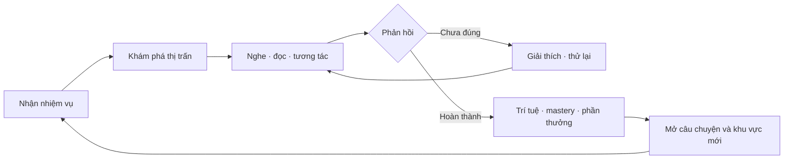
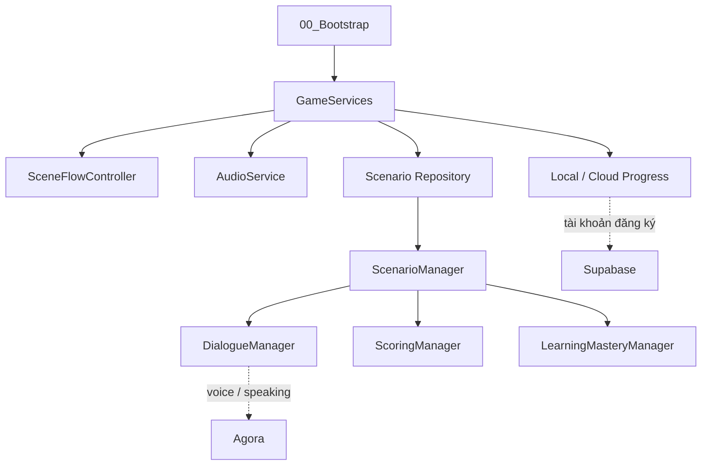

<div align="center">

# NihongoLife · 日本語ライフ

### Học tiếng Nhật bằng cách sống trong một thế giới Nhật Bản thu nhỏ.

Game mô phỏng cuộc sống 3D dành cho người Việt: khám phá **Hibari-chō**, giao tiếp với NPC, đi học, làm thêm, mua sắm, đi tàu và luyện ngôn ngữ qua những tình huống thật.

[](NihongoLife/ProjectSettings/ProjectVersion.txt)
[](#chạy-dự-án)
[](#trải-nghiệm-nổi-bật)
[](LICENSE)
[](https://www.youtube.com/@NihongoLifeGame)

[Khám phá game](#nihongolife-là-gì) · [Xem video](#video--gameplay) · [Lộ trình](#hướng-phát-triển) · [Chạy dự án](#chạy-dự-án) · [Đóng góp](#đóng-góp) · [English](#english-summary)

</div>

---

## NihongoLife là gì?

NihongoLife biến việc học tiếng Nhật thành một cuộc sống để khám phá. Thay vì ghi nhớ những câu rời rạc, người chơi dùng tiếng Nhật ngay trong ngữ cảnh: chào hàng xóm, hỏi giá vé, mua onigiri, gọi món sushi, tham gia lớp học, làm thêm và vui chơi sau giờ học.

Bạn vào vai một học sinh mới tại **Hibari-chō (ひばり町)**. Mỗi nhiệm vụ là một tình huống giao tiếp; mỗi lựa chọn là một cơ hội luyện nghe, đọc, từ vựng và phản xạ. Trả lời sai không kết thúc cuộc chơi — game giải thích, cho thử lại và giúp người chơi hiểu vì sao.

> **Tinh thần của NihongoLife:** Nói sai cũng không sao. Quan trọng là dám dùng tiếng Nhật trong đúng hoàn cảnh.

<p align="center"></p>

## Video & gameplay

<p align="center">
  <a href="https://www.youtube.com/@NihongoLifeGame"></a><br />
  <sub>Nhấn vào hình để xem trailer, gameplay và nhật ký phát triển trên kênh YouTube chính thức.</sub>
</p>

<div align="center">

### [▶ Xem NihongoLife trên YouTube](https://www.youtube.com/@NihongoLifeGame)

</div>

GitHub không hỗ trợ trình phát YouTube nhúng trực tiếp trong README. Ảnh động phía trên đóng vai trò preview và dẫn về kênh chính thức, nên README vẫn hoạt động khi danh sách video thay đổi.

## Trải nghiệm nổi bật

### Một thị trấn để học và sống

Hibari-chō không chỉ là phông nền. Người chơi có thể đi qua phố, cửa hàng tiện lợi, ga tàu, nhà hàng sushi, trường học, phòng trọ, Game Center và mở rộng hành trình tới đảo Midori.

<table>
  <tr>
    <td width="50%"><br /><sub>Khám phá các khu vực trong thị trấn.</sub></td>
    <td width="50%"><br /><sub>Hỏi đường, mua vé và di chuyển bằng tàu.</sub></td>
  </tr>
  <tr>
    <td width="50%"><br /><sub>Mua sắm và luyện hội thoại đời thường.</sub></td>
    <td width="50%"><br /><sub>Một ngày mới bắt đầu từ căn phòng của bạn.</sub></td>
  </tr>
</table>

### Học qua hội thoại có ngữ cảnh

Hệ thống hội thoại dùng chung hiển thị tiếng Nhật, cách đọc và nghĩa tiếng Việt tùy theo chế độ học. Người chơi có thể học có hướng dẫn, luyện tập hoặc tự kiểm tra; lựa chọn sai nhận phản hồi và cơ hội sửa lại ngay.

<p align="center"></p>

### Học mà vẫn là một trò chơi

- Nhiệm vụ cốt truyện, story flags và scenario theo dữ liệu.
- Mua sắm, hành trang, bản đồ, việc làm thêm và vòng lặp ngày/đêm.
- Tám nhân vật có thể chơi: Haruto, Yui, Sota, Hina, Riku, Mio, Yuto và Sakura.
- Sáu máy tại Game Center: Kana Match, Word Shooter, Order Rush, Kana Rain, UFO Catcher và Basket Count.
- Trồng trọt, câu cá và khám phá đảo Midori.
- Tâm trạng, danh tiếng, thể lực và tiến trình học tác động tới trải nghiệm.

<table>
  <tr>
    <td width="50%"><br /><sub>Mini-game củng cố kana và từ vựng.</sub></td>
    <td width="50%"><br /><sub>Học, chơi và nhận phần thưởng.</sub></td>
  </tr>
  <tr>
    <td width="50%"><br /><sub>Lớp học kết nối nội dung với tiến trình.</sub></td>
    <td width="50%"><br /><sub>Những chuyến đi mở ra khu vực và tình huống mới.</sub></td>
  </tr>
</table>

### JLPT & IELTS trong thế giới game

NihongoLife có các hoạt động luyện tập theo dạng JLPT và IELTS cho đọc, nghe, viết và nói. Kết quả trong game phục vụ luyện tập và theo dõi tiến bộ, **không phải điểm thi chính thức** và dự án không đại diện cho các tổ chức kỳ thi.

Ngoài luyện thi, tab **ENGLISH** có lộ trình tiếng Anh tổng quát gồm **20 unit / 60 câu**, phủ CEFR A1–C1 theo bốn kỹ năng Nghe–Nói–Đọc–Viết. Mẫu câu, ngữ pháp, điền từ và từ vựng được đặt trong từng ngữ cảnh kỹ năng. Nội dung do đội ngũ tự soạn để học offline và dẫn dắt người mới từ nền tảng tới giai đoạn luyện IELTS.

<p align="center">
  
  
</p>

### Offline rộng mở, online có trách nhiệm

| Chế độ | Trải nghiệm |
|---|---|
| **Khách / offline** | Toàn bộ thị trấn được mở; tiến trình lưu trên thiết bị trong `guest_progress.json`. |
| **Tài khoản đăng ký** | Chơi campaign theo cốt truyện và mốc **trí tuệ**, có save riêng cho từng tài khoản và được dùng tính năng online. |

Chat, bạn bè, co-op, voice, Speaking room, thăm đảo và gửi điểm xếp hạng yêu cầu tài khoản đã đăng ký. Khi người chơi khách đăng nhập lần đầu vào tài khoản mới, tiến trình khách có thể được chuyển sang tài khoản đó; tài khoản đã có dữ liệu luôn giữ save riêng.

| Trí tuệ | Khu vực mở |
|---:|---|
| 100 | Nhà hàng sushi |
| 160 | Ga tàu |
| 240 | Game Center |
| 320 | Đảo Midori |

## Vòng lặp trải nghiệm



## Hướng phát triển

NihongoLife được phát triển theo hướng **life-sim học ngôn ngữ có thể chơi lâu dài**, nơi nội dung học, thế giới và kết nối cộng đồng bổ trợ cho nhau.

### 1. Trải nghiệm học tập hoàn chỉnh

- Mở rộng scenario đời sống từ N5 lên các cấp độ cao hơn.
- Bổ sung giọng đọc tự nhiên, phản hồi phát âm và hội thoại có chiều sâu.
- Hoàn thiện tuyến JLPT/IELTS với kết quả có thể truy vết từ mục tiêu học tới mastery.
- Giữ triết lý “sai để học”: mọi lỗi đều có giải thích, đường thử lại và kết quả đo được.

### 2. Thế giới sống động hơn

- Hoàn thiện NPC, animation, lịch sinh hoạt và phản ứng theo tâm trạng/danh tiếng.
- Mở rộng hoạt động tại trường, công việc, Game Center và đảo Midori.
- Nâng chất lượng ánh sáng, âm thanh, camera, va chạm và khả năng dẫn đường.
- Tối ưu để thị trấn ổn định trên máy tính, thiết bị cảm ứng và trình duyệt.

### 3. Online & cộng đồng

- Ưu tiên chat, bạn bè, co-op, voice và Speaking room cho tài khoản đăng ký.
- Đồng bộ tiến trình an toàn giữa local save, tài khoản và cloud.
- Hoàn thiện realtime trên WebGL mà vẫn giữ trải nghiệm offline độc lập.
- Phát triển bảng xếp hạng và hoạt động cộng đồng khuyến khích học tập lành mạnh.

### 4. WebGL & khả năng tiếp cận

- Rút ngắn thời gian tải và giảm dung lượng build.
- Hoàn thiện responsive UI cho desktop, tablet và điện thoại.
- Bảo đảm lưu IndexedDB, nhập liệu, âm thanh và dịch vụ web hoạt động nhất quán.
- Đưa game lên website để người học vào chơi nhanh mà không cần cài đặt.

> Trạng thái kỹ thuật chi tiết nằm trong [`ROADMAP.md`](NihongoLife/Docs/ROADMAP.md) và [`TODO_CHECKLIST.md`](NihongoLife/Docs/TODO_CHECKLIST.md). Roadmap là định hướng, không phải cam kết ngày phát hành.

## Kiến trúc tổng quan

Nội dung học được tách khỏi runtime bằng scenario data-driven. `00_Bootstrap` khởi tạo dịch vụ dùng xuyên scene; gameplay giao tiếp qua interface để local save, cloud save và nguồn nội dung có thể thay thế mà không phải viết lại hội thoại.



Tài liệu sâu hơn: [`ARCHITECTURE.md`](NihongoLife/Docs/ARCHITECTURE.md) · [`SCENARIO_SYSTEM.md`](NihongoLife/Docs/SCENARIO_SYSTEM.md) · [`EXAM_SYSTEM.md`](NihongoLife/Docs/EXAM_SYSTEM.md) · [`WEB_INTEGRATION_API.md`](NihongoLife/Docs/WEB_INTEGRATION_API.md)

## Chạy dự án

### Yêu cầu

- Unity **6000.3.12f1**.
- Git; Git LFS nếu bản clone sử dụng asset được quản lý bằng LFS.
- Windows cho quy trình phát triển chính; WebGL Build Support nếu build web.

### Cài đặt

```bash
git clone https://github.com/StephenSouth13/NihongoLife.git
cd NihongoLife
```

1. Mở thư mục `NihongoLife/` bên trong repo bằng Unity Hub.
2. Mở `Assets/NihongoLife/Scenes/00_Bootstrap.unity`.
3. Nhấn **Play**. Scene bootstrap sẽ khởi tạo dịch vụ và chuyển tới menu chính.

Project chạy offline dù chưa có dịch vụ cloud. Nếu cần tích hợp online, tạo file secrets cục bộ từ mẫu:

```bash
cp NihongoLife/LocalSecrets/secrets.example.json NihongoLife/LocalSecrets/secrets.json
```

Các cấu hình hỗ trợ gồm `NIHONGOLIFE_SUPABASE_URL`, `NIHONGOLIFE_SUPABASE_ANON_KEY`, `AGORA_APP_ID` và `NIHONGOLIFE_GEMINI_API_KEY`. **Không commit secrets, service-role key, mật khẩu hoặc tài liệu đề thi có bản quyền.**

## Điều khiển mặc định

| Hành động | Phím |
|---|---|
| Di chuyển / chạy / nhảy | `WASD` / `Left Shift` / `Space` |
| Tương tác | `F` |
| Balo / bản đồ / nhật ký | `B` / `M` / `N` |
| Dùng / thả vật phẩm | `C` / `G` |
| Biểu cảm / đổi mục tiêu | `E` / `Q` |
| Hội thoại, chat | `Enter` |
| Push-to-talk / voice | giữ `T` / `V` |
| Bạn bè / cửa hàng / cài đặt | `U` / `P` / `O` |
| Nhân vật / tạm dừng | `Tab` / `Esc` |
| Xoay camera | `,` / `.` |

Phím có thể đổi trong Cài đặt. Bản cảm ứng và WebGL có joystick, vùng nhìn và action buttons riêng; bàn phím vẫn dùng được khi trình duyệt hỗ trợ.

## Kiểm thử & build

Unity chỉ có thể mở project một lần. Đóng Unity Editor trước khi chạy batch test:

```powershell
Unity -batchmode -projectPath NihongoLife -runTests -testPlatform PlayMode -testResults D:\NihongoLife-TestResults.xml -logFile D:\NihongoLife-PlayMode.log
Unity -batchmode -projectPath NihongoLife -runTests -testPlatform EditMode -testResults D:\NihongoLife-EditMode.xml -logFile D:\NihongoLife-EditMode.log
```

Kiểm tra compile WebGL:

```powershell
Unity -batchmode -quit -buildTarget WebGL -projectPath NihongoLife -logFile D:\NihongoLife-WebGL.log
```

Builder và sửa scene chạy headless qua `-executeMethod`; dự án không dùng setup thủ công bằng `[MenuItem]`. Đọc [`AGENTS.md`](AGENTS.md) trước khi sửa gameplay, scene hoặc asset pipeline.

## Đóng góp

Pull request được chào đón:

1. Đọc [`AGENTS.md`](AGENTS.md) và [`TEAM_TASKS.md`](NihongoLife/Docs/TEAM_TASKS.md).
2. Giữ thay đổi tập trung; không viết lại hệ thống đang hoạt động chỉ vì khác phong cách.
3. Thêm hoặc cập nhật test chứng minh hành vi.
4. Với thay đổi hình ảnh, kiểm tra Play Mode và lưu capture dưới `Bao_Cao/<topic>/`.
5. Chạy nhóm test liên quan, sau đó chạy full suite trước khi push.

## Đội ngũ

**The Next Generation · VTC Academy**

- **Quách Thành Long** — Trưởng nhóm · Lập trình web & game
- **Nguyễn Lê Gia Huy** — Nhân vật · Animation · Gameplay
- **Lương Nguyễn Tấn Dũng** — Nhân vật · Animation · Gameplay

[Website đội ngũ](https://website-the-next-generation-o323.vercel.app/team) · [Kênh YouTube](https://www.youtube.com/@NihongoLifeGame)

<p align="center">
  <br />
  <sub>Giải Triển vọng · Unique Project 2025 · VTC Academy</sub>
</p>

## Giấy phép & ghi công

Mã nguồn được phát hành theo [MIT License](LICENSE). Âm thanh và âm nhạc có giấy phép riêng được ghi tại [`AUDIO_CREDITS.md`](NihongoLife/Docs/AUDIO_CREDITS.md); hình ảnh, model và package bên thứ ba giữ giấy phép của nguồn tương ứng.

---

## English summary

**NihongoLife** is a 3D Japanese-learning life simulation made for Vietnamese learners. Instead of studying isolated exercises, players live in Hibari-chō and practise through everyday situations: greeting neighbours, shopping, ordering food, attending class, taking the train, working part-time and exploring Midori Island.

The game combines contextual dialogue, story quests, progression, mini-games, JLPT/IELTS-style practice and optional registered-account online features. Guests can explore the full town offline with device-local progress; registered accounts follow the campaign, keep separate saves and can access social features.

Development focuses on richer learning content, a more responsive living world, secure online communication, exam experiences and a fast, accessible WebGL release. Open `NihongoLife/` with Unity **6000.3.12f1**, start from `00_Bootstrap.unity`, and read [`AGENTS.md`](AGENTS.md) before contributing.

**Watch development videos:** [youtube.com/@NihongoLifeGame](https://www.youtube.com/@NihongoLifeGame)
