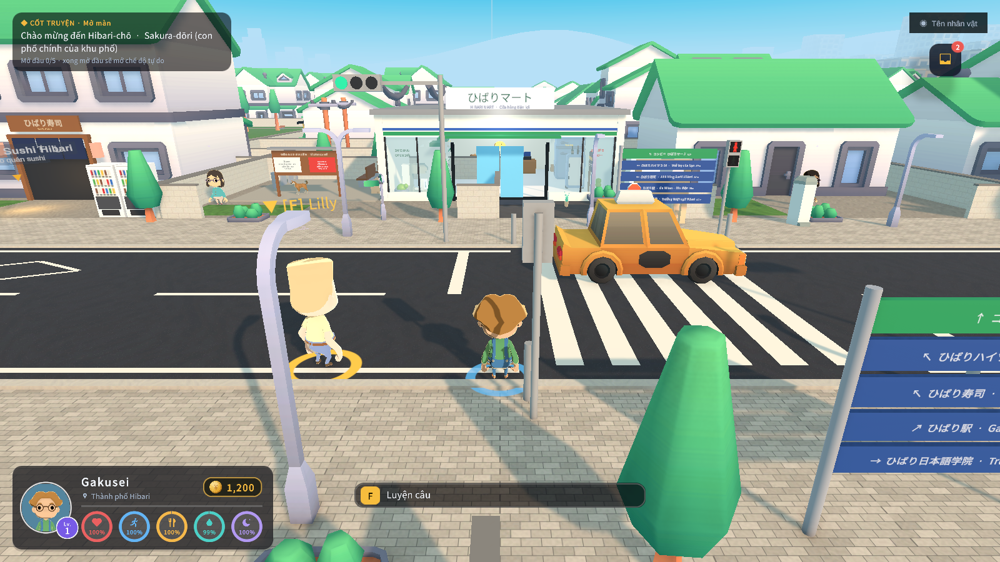
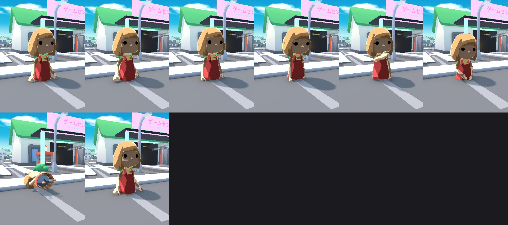
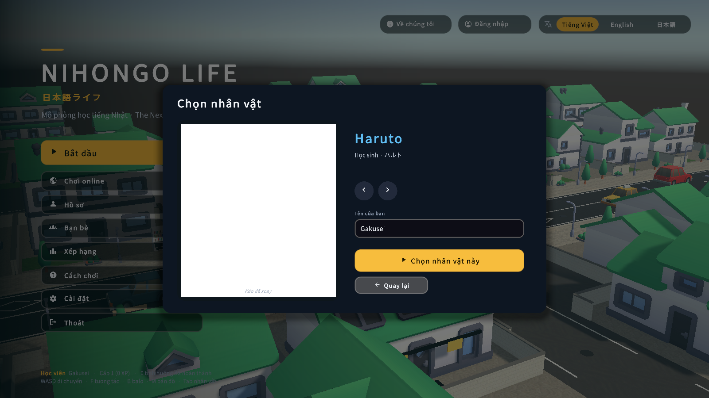
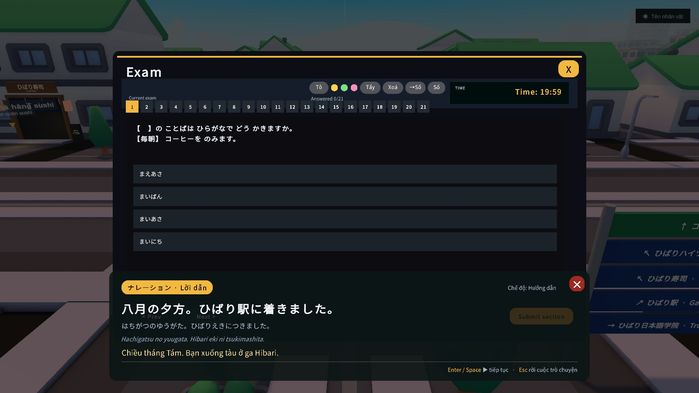
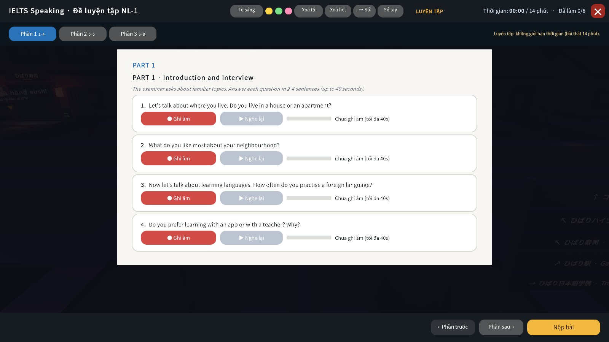
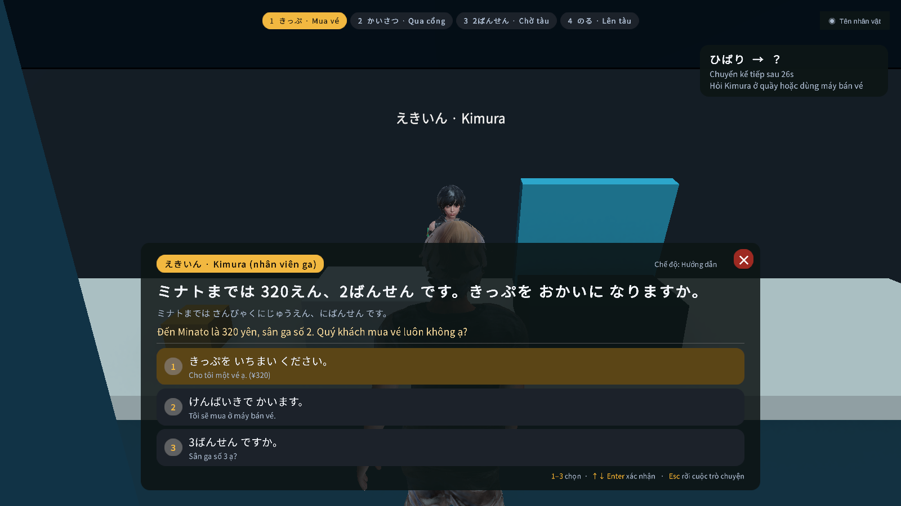
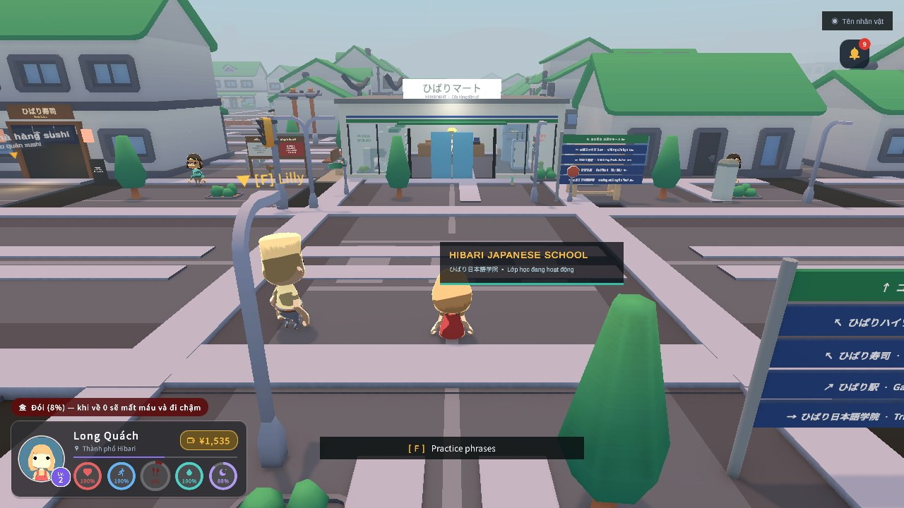
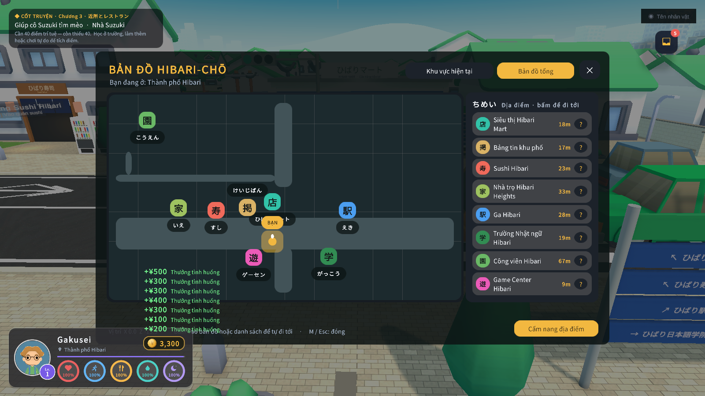
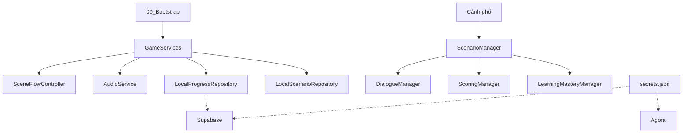

<div align="center">



<br/>

[](NihongoLife/ProjectSettings/ProjectVersion.txt)
[](NihongoLife/Assets/WebGLTemplates/NihongoLife)
[](LICENSE)
[](#đóng-góp)

**Học tiếng Nhật bằng cách sống ở Nhật.**

Game 3D mô phỏng cuộc sống ở khu phố Hibari-chō (ひばり町), cho người Việt luyện tiếng Nhật trong việc hàng ngày.

[Chơi trên web](#chơi-trên-web) · [Bắt đầu](#bắt-đầu-nhanh) · [Điều khiển](#điều-khiển) · [Kiến trúc](#kiến-trúc) · [Lộ trình](#lộ-trình) · [Đóng góp](#đóng-góp) · [English](#english)

</div>

---

## NihongoLife là gì

Bạn vào phố, chào hàng xóm, mua cơm nắm, hỏi giá vé, ngồi lớp, gọi sushi, tan học thì ra Game Center, và khi lộ trình tới thì ra đảo Midori. Chọn sai trong hội thoại thì được giải thích và chọn lại.

Người chơi là tám bé trong `PlayableCharacterCatalog`: **Haruto** (mặc định), Yui, Sota, Hina, Riku, Mio, Yuto, Sakura. Prefab nằm ở `Resources/Characters/Kids/NL_kid_*`. Save cũ còn id `student` được chuyển sang Haruto.

Giao diện có tiếng Việt, English và 日本語. Chữ tiến trình trên UI tiếng Việt là **trí tuệ**.

<table>
<tr>
<td width="33%"><br/><sub>Màn chọn nhân vật. Haruto là mặc định.</sub></td>
<td width="33%"><br/><sub>Haruto, bộ pose đã chụp trong Play Mode.</sub></td>
<td width="33%"><br/><sub>Yui, cùng dòng model.</sub></td>
</tr>
</table>

Một số ảnh Play Mode trong `Bao_Cao/` còn thanh dev ở mép dưới. Đó là ảnh kiểm thử, chụp khi người chơi đã là tám bé.

## Trong game

### Nói chuyện online

Chat khu vực, thẻ người chơi, kết bạn và chặn có trong game. Giữ **T** để nói (push-to-talk). Voice và phòng Speaking đi qua Agora. Điền `AGORA_APP_ID` trong `secrets.json` thì dịch vụ mới bật. Chưa cấu hình thì game vẫn chơi ngoại tuyến.

<table>
<tr>
<td width="50%"><br/><sub>Chat khu vực. Avatar là bé.</sub></td>
<td width="50%"><br/><sub>Tài khoản đã đăng ký, đứng cùng phố.</sub></td>
</tr>
</table>

### Luyện theo dạng JLPT và IELTS

Trong lớp có bài dạng JLPT và dạng IELTS (đọc, nghe, viết, nói). Điểm trong game không phải kết quả chính thức, và repo không gắn logo của kỳ thi. Gói đề IELTS có bản quyền để ở `LocalContent/IELTS/`, không đưa vào git.

<table>
<tr>
<td width="50%"><br/><sub>Một câu từ vựng trong lớp.</sub></td>
<td width="50%"><br/><sub>Phòng luyện nói. Bé ngồi đối diện.</sub></td>
</tr>
</table>

### Phố, ga, đảo

Hibari-chō có phòng trọ, konbini, ga, quán sushi, trường, Game Center. Đảo Midori có luống và chỗ câu. Với tài khoản, `LocationUnlocks` mở sushi ở 100 trí tuệ (sau konbini), ga ở 160 (sau sushi), Game Center ở 240 (sau tàu), đảo ở 320 (sau Game Center).

<table>
<tr>
<td width="33%"><br/><sub>Phố, ngay lúc vào.</sub></td>
<td width="33%"><br/><sub>Trong truyện, vé tới Minato là 320 yên.</sub></td>
<td width="33%"><br/><sub>Đảo Midori, cuốc trước luống.</sub></td>
</tr>
</table>

Sáu máy Game Center, đúng tên trong `ArcadeGame`: Kana Match, Word Shooter, Order Rush, Kana Rain, UFO Catcher, Basket Count.

### Tâm trạng và danh tiếng

`SocialStanding` giữ tâm trạng (vui, ngại, tự tin, căng, mệt, hứng, tự hào, bực, hoặc trung tính), danh tiếng và tai tiếng. Mỗi chỉ số tối đa 100. Tâm trạng đổi hệ số XP một chút và đổi câu NPC nói. Phần này chạy cả khi chơi khách, không nhìn cấp tài khoản.

<table>
<tr>
<td width="50%"><br/><sub>Một tư thế mệt của Haruto.</sub></td>
<td width="50%"><br/><sub>Đói và khát trên HUD.</sub></td>
</tr>
</table>

### Chơi khách, không khoá cấp

Khách chơi ngoại tuyến và cả phố mở, vì `PlayerSessionService.OpenWorld`. Tài khoản đã đăng ký đi lộ trình trí tuệ và vào được phần online. Ngủ trong phòng đưa đồng hồ tới sáng hôm sau, mặc định 7:00.



## Chơi trên web

Chưa có URL chơi công khai trong repo. Khi bản WebGL được host, điền URL thật vào mục này. Đừng điền một địa chỉ giả.

Mẫu trang WebGL nằm ở `NihongoLife/Assets/WebGLTemplates/NihongoLife`.

## Bắt đầu nhanh

Cần Unity **6000.3.12f1** (`NihongoLife/ProjectSettings/ProjectVersion.txt`).

```bash
git clone https://github.com/StephenSouth13/NihongoLife.git
cd NihongoLife
```

Mở thư mục `NihongoLife/` bằng Unity Hub (đó là project, không phải gốc repo).

Secrets không vào git. Copy file mẫu rồi điền giá trị của mình. Dòng còn dấu `<...>` bị bỏ qua, nên file mẫu để nguyên thì game chơi ngoại tuyến.

```bash
cp NihongoLife/LocalSecrets/secrets.example.json NihongoLife/LocalSecrets/secrets.json
```

Các khoá: `NIHONGOLIFE_SUPABASE_URL`, `NIHONGOLIFE_SUPABASE_ANON_KEY` (anon key, không phải service role), `AGORA_APP_ID`, `NIHONGOLIFE_GEMINI_API_KEY`. Biến môi trường cùng tên ghi đè file.

Bấm Play. Không có bước dựng scene bằng menu editor.

## Điều khiển

Phím mặc định trong `GameInputService`. Đổi trong màn hình cài đặt.

| Việc | Phím |
|---|---|
| Đi | W A S D |
| Chạy | Shift trái |
| Nhảy | Space |
| Tương tác | F |
| Balo | B |
| Bản đồ | M |
| Dùng vật phẩm | C |
| Biểu cảm | E |
| Hội thoại / chat | Enter |
| Nói, giữ để nói | T |
| Voice | V |
| Nhật ký | N |
| Bạn bè | U |
| Cửa hàng | P |
| Cài đặt | O |
| Nhân vật | Tab |
| Thả đồ | G |
| Tạm dừng | Esc |
| Xoay nhìn | Q, hoặc dấu phẩy / chấm |
| Con trỏ | Ctrl trái |
| Tay cầm | Cột gamepad cạnh phím, trong cùng file |

Trên máy cảm ứng và trên WebGL khi trình duyệt báo con trỏ thô, `TouchControlOverlay` hiện joystick, vùng nhìn, và nút nhảy, tương tác, chạy, bản đồ, balo, chat, giữ để nói, cài đặt. Bàn phím vẫn dùng được.

## Kiến trúc

Nội dung (kịch bản, câu thoại) tách khỏi máy chạy. `00_Bootstrap` giữ `GameServices`. Cảnh chơi hỏi dịch vụ qua interface, nên save local và save Supabase đổi được mà không viết lại hội thoại. Sơ đồ dưới đây bám `NihongoLife/Docs/ARCHITECTURE.md`.



`DialogueManager` có ba chế độ: hướng dẫn, luyện, kiểm tra. Chế độ quyết định có hiện cách đọc và nghĩa Việt hay không.

## Lộ trình

Repo chưa ghi ngày phát hành. Việc đội đang theo dõi nằm ở `NihongoLife/Docs/TEAM_TASKS.md`.

Mốc trí tuệ 100 / 160 / 240 / 320 là luật mở cửa của tài khoản trong game.

## Đóng góp

Pull request được chào. Đọc `AGENTS.md` trước khi sửa cảnh hoặc gameplay: không thêm `[MenuItem]` cho bước dựng, không chồng một môi trường mới lên môi trường đang có, và Play phải vào đúng trạng thái đã lưu trong scene.

Không commit `secrets.json`, key, hay đề thi có bản quyền.

Ba nhà sáng lập, The Next Generation, VTC Academy:

- Quách Thành Long — trưởng nhóm, web và game
- Nguyễn Lê Gia Huy — nhân vật, animation và gameplay
- Lương Nguyễn Tấn Dũng — nhân vật, animation và gameplay

Trang đội: https://website-the-next-generation-o323.vercel.app/team

Giải Triển vọng, Unique Project 2025, VTC Academy.


## Giấy phép

Mã nguồn là [MIT](LICENSE). Nhạc CC0 ghi ở `NihongoLife/Docs/AUDIO_CREDITS.md`. Ảnh và model bên thứ ba giữ giấy phép của gói đó.

---

## English

NihongoLife is a 3D life-sim in the Hibari-chō neighbourhood. Daily errands are Japanese practice: greet a neighbour, buy onigiri, ask a fare, sit an in-game paper, order sushi, play a kana machine, and later farm on Midori island.

The playable cast is eight kids. Haruto is the default. A guest plays offline with the whole town open. A registered account follows the knowledge route (trí tuệ) and can go online. Chat, friends, block, and push-to-talk (hold T) are in the game. Agora, Supabase and Gemini stay off until `NihongoLife/LocalSecrets/secrets.json` is filled from `secrets.example.json`.

In-game JLPT-style and IELTS-style practice is not an official score, and this repo does not use those organisations' logos.

Open `NihongoLife/` in Unity 6000.3.12f1 and press Play. There is no public play URL in the repo yet. The WebGL host template is `NihongoLife/Assets/WebGLTemplates/NihongoLife`.

Three founders: Quách Thành Long (lead, web and game), Nguyễn Lê Gia Huy and Lương Nguyễn Tấn Dũng (characters, animation and gameplay). The Next Generation, VTC Academy. Prospect Award, Unique Project 2025.

Code license: MIT.
